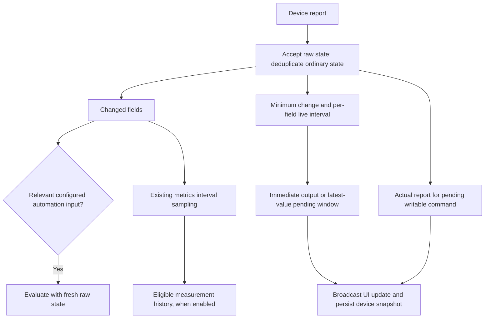

# Backend Architecture: Device Update Flow

This document describes the lifecycle of an incoming device update payload and how it routes through the system.

## Overview

When a device payload arrives, `DeviceLifetimeService` first updates raw state and
builds a changed-field delta. UI observations, command confirmations, automation input
selection and metric sampling have distinct policies ([spec 012](../../specs/012-sensor-reporting/spec.md),
[category reporting](../../specs/014-category-reporting/spec.md)).

### Ordering (spec 005)

MQTT/HTTP messages enter the ingress lane, then a lane per device, in arrival order.
Different devices may run concurrently. A device's accepted state is visible before
its automation callback. Raw state is authoritative; observation filtering never changes
what a condition or action reads. See `internal/controllers/hub-controller.go` and
`internal/services/device_lifetime.go` for the current contract.

### Observations and noisy numeric sensors

`models/settings/reporting_policy.go` resolves output policy from saved configuration.
The same ordered lookup supports live and history intervals: device field, global
field, device category, global category, then immediate. Missing fields inherit; explicit zero means
every change. `liveIntervalByCategory` and `liveIntervalOverrides` control live
output; existing `defaultDebounceByCategory` and `debounceOverrides` control history.
Device category overrides affect only that device; removing an override resumes
inheritance. Individual sensor rules remain more specific than category rules.
There are no sensor-name-specific timing rules. The shared declarative bootstrap
JSON provides 30 seconds for numeric diagnostics and zero for measurements.
The backend file is canonical; `scripts/sync-reporting-defaults.mjs --write` generates
a checked-in frontend-local copy for browser/mock consumers. CI rejects missing or
stale artifacts with `--check`. Frontend builds never import outside their build
context; see the [frontend guide](../../frontend/README.md#shared-reporting-defaults). Missing
live category settings in older configurations are hydrated; explicit empty maps
and zero survive reload. Existing history intervals retain their meaning.

`internal/services/observation_publisher.go` composes numeric delta checks and live
intervals. Within an interval it retains the latest qualifying value per field and
flushes at the original deadline even if reports stop. New reports never postpone
the deadline. A field returning within its minimum-change tolerance cancels its
pending observation, rather than publishing an intermediate spike. Multiple fields
due together share one update. Unknown/invalid values, recovery, binary/enums,
physical events and writable reports bypass interval filtering. Availability changes
remain independent. A delayed update carries the current raw last-seen timestamp.

`models/devices/observation_filter.go` compares with the last published numeric
baseline, so small changes accumulate. Optional `reportingThresholds` resolve device
field then global field; absent means zero. Values use each sensor's native unit.
A link threshold of 10 suppresses 131/134/138 oscillation; 144 is significant relative
to 134 and becomes the baseline when published. There is no automatic unit conversion
or noise learning. Device exceptions cover different units for the same property.

The publisher owns a mutex, one baseline/timestamp per known field, one latest pending
value per delayed field and at most one timer per device. It creates no per-report
workers or timers. Generation tokens reject stale timer callbacks. Output callbacks
run under that mutex and must not re-enter the publisher; they do not run automations
or change raw values. Hub context cancellation closes publication; disable and offline
clear pending output. Configuration edits re-evaluate retained readings with current
policy, preserving the publication-time anchor so unrelated edits cannot lose the
final live value. Existing history sampling is separate and still has no trailing flush.

Cached unchanged writable configuration settings do not force broadcasts. Actuator
measurement echoes retain their existing confirmation behavior. The UI command handler
marks one nonserialized confirmation interest on the requested entity before publishing
a command. Its duration comes from `commandConfirmationTimeoutMs`, resolved from device
override, hub default, then the shared declarative compatibility bootstrap JSON. Only an actual next report consumes it. It neither updates state
optimistically nor retriggers automation for an unchanged value. Expired interests are
inert and own no timers/resources. The frontend reads the same setting for its pending command timer, clears pending
work on a hub reset, and does not retry commands automatically. Settings forms can edit
or remove device timeout overrides without changing source code.

### Device retirement

Successful bridge removal runs on the same friendly-name lane as device reports.
The processor supplies the active name even before a first snapshot reaches storage,
so removal cannot bypass an in-flight Seed. Delayed live callbacks run outside that
lane; the publisher's output mutex fences storage deletion behind any snapshot write.
Only a successful deletion closes publication. Failure preserves the existing service,
monitoring and pending reading and is reported through the existing bridge response.

A lifetime owns a child context. Retirement cancels it, unregisters publisher shutdown
callbacks, stops and joins all availability workers (including previously disabled
workers still exiting), and evicts that exact processor entry and pending creation
queue. Old references cannot be re-enabled or accept reports. Hub cancellation also
cancels the child/monitor contexts. Registry locks never surround persistence or output.
Close/Retire run outside lifetime callbacks; the controller supplies lane ordering.

Repeated removal is safe with existing repositories. Later accepted rediscovery uses
a fresh service, preserving existing device discovery semantics; no permanent blacklist
or tombstone map is retained. Tests use isolated stores, channels and fake clocks;
see [retirement spec](../../specs/016-device-service-cleanup/spec.md).

### Automation routing

Each configured device recipe has an immutable, derived set of primary and condition
input names. The current published generation owns its set; replacement/reload builds a
new one. Unrelated telemetry is rejected before a run context or condition evaluation.
Unknown custom trigger/condition implementations conservatively retain full routing.
`Trigger.AffectedBy` remains authoritative: state conditions can re-evaluate on relevant
numeric changes; cached physical events cannot replay on unrelated updates. Manual runs
use their explicit path. Filtering UI observations never filters automation inputs.

### Metric sampling

Legacy settings named debounce are leading-edge interval sampling, not a wait for a
quiet period. Category defaults are 60 seconds for measurements and 300 seconds for
diagnostics; binary/enums bypass intervals. Schema measurement fields reach metrics storage when enabled, unless explicitly
excluded. The optional `metricOverrides` map can include/exclude any field, including
fields supplied as diagnostic metadata; device entries override global entries.
Target distance is a measurement even when bridge metadata labels it diagnostic.
Stored diagnostic measurements normalize on load using the same measurement taxonomy
as discovery, preserving readings and explicit overrides. Measurements have no default
live interval or minimum-change suppression; history sampling remains separate.
No past records are backfilled or rewritten.

The interval sampler has no trailing flush: a changed value suppressed inside a window,
followed only by identical reports, can remain absent from history. This limitation is
separate from the live publisher, which does flush the latest eligible reading. Retention and metric timestamp
semantics remain unchanged. See `models/settings/cache.go` for actual legacy precedence.

## Automation reload and failures

The engine's runtime registry contains only configured generations. Storage holds
persisted recipes; loading a recipe does not make it executable. Reads, enabled
checks and triggers keep using the last working generation while replacements are
prepared. Load/configuration/handler/save failures retain it and are logged/returned.
First-load failures remain unavailable. A failed disk scan never implies deletion.

Schedules prepare owned replacements and roll back on failure. Matching time/type
sets preserve the current enabled window (including reordered lists), but callbacks
bind the replacement object. Removed/replaced schedules cancel timers and context
watchers; already committed callbacks may finish against their old generation.
Already accepted actions, including delayed commands, may finish after replacement
or deletion. Reload does not join commands, retry them, or confirm physical state.

Management writes are single-owner: overlapping/re-entrant save/delete requests
return an update-in-progress error; callers may retry after completion. Triggers and
reads do not wait for preparation. Immediate execution errors reach manual callers;
physical/asynchronous failures are logged. Later actions still run if one fails.
An existing trigger whose conditions do not match remains a successful no-op.

Recipe saves sync a staged file, then replace atomically in the same directory,
preserving existing permission bits and valid symlink targets. The configuration
directory must be writable (Compose mounts the directory). This is not a multi-file
transaction or a guarantee against power-loss/directory-metadata corruption.

Observed explicit Z2M source disable overrides failure fallback: remove executable
access before retiring schedules. Cleanup failure is reported and retried on reload,
never restores execution. Persisted recipes remain for successful later re-enable;
already accepted commands remain non-joining. Ordinary configuration/save failures
retain working generations. Disable is observed through existing configure/reload
paths, not new polling. See [FR-20](../../specs/003-backend-race-repair/plan.md).
